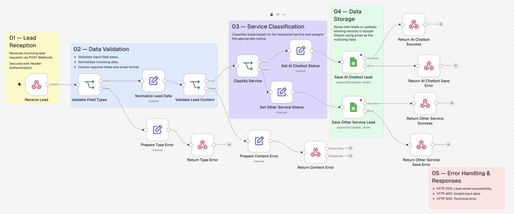
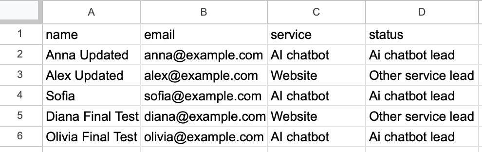
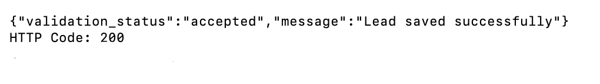
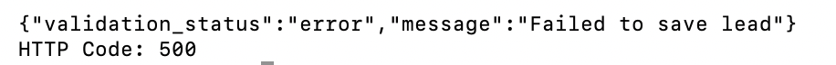

# n8n Lead Intake & Management

A business automation workflow for authenticated lead intake, data validation, service classification, and Google Sheets integration.

## Project Overview

This project automates incoming customer requests, validates and normalizes submitted data, classifies leads by requested service, and creates or updates customer records in Google Sheets.

## Workflow Architecture



The workflow consists of five main stages:

1. Lead Reception
2. Data Validation and Normalization
3. Service Classification
4. Data Storage
5. Error Handling and HTTP Responses

## Key Features

- POST Webhook integration
- API key authentication using Header Auth
- Input data type validation
- Data normalization
- Required field validation
- Email format validation
- Rule-based service classification
- Google Sheets integration
- Email-based record matching and updates
- Duplicate prevention for sequential requests
- Technical error handling
- Structured HTTP responses

## Technology Stack

- n8n
- Google Sheets
- REST API
- JSON
- JavaScript Expressions
- Regular Expressions (Regex)
- cURL

## Installation and Setup

1. Download the workflow.json file.
2. Import the file into n8n.
3. Create a Header Auth credential.
4. Set the header name to x-api-key and use your own secure secret value.
5. Assign the credential to the Receive Lead node.
6. Create a Google spreadsheet with a sheet named Leads.
7. Add the following column headers:

   name | email | service | status

8. Connect your Google Sheets credentials to both storage nodes.
9. Replace YOUR_SPREADSHEET_ID with your spreadsheet ID in both storage nodes.
10. Verify the field mappings and email matching column.
11. Test the workflow before publishing.

## Example Request

Method: POST

Content-Type: application/json

Authentication header: x-api-key

```json
{
  "name": "Emily",
  "email": "emily@example.com",
  "service": "AI chatbot"
}
```

## HTTP Responses

| Status Code | Description |
| --- | --- |
| 200 | Lead saved successfully |
| 400 | Invalid input data or field types |
| 403 | Authentication rejected |
| 500 | Lead storage error |

## Google Sheets Integration



The workflow uses the Append or Update Row operation with email as the matching field.

## Successful Request



## Validation Error


## Technical Error Handling



## Testing

The exported workflow was re-imported into n8n and tested using a separate Google spreadsheet.

All five final import test scenarios passed.

Detailed test results are available in [TESTING.md](TESTING.md).

## Security

Personal credential references and spreadsheet identifiers have been removed from the distributed workflow.

Users must configure their own credentials before execution.

Never expose API keys in public repositories or client-side code.

## Project Status

Functional portfolio project.

Service classification is rule-based and does not require an AI model.

Additional security, monitoring, concurrency testing, and scalability measures are required for production use.
