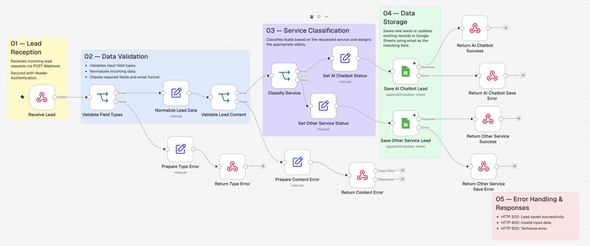
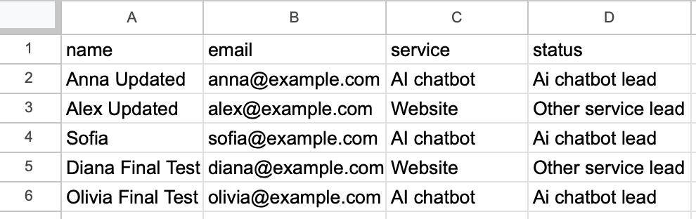
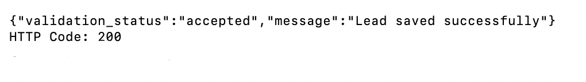
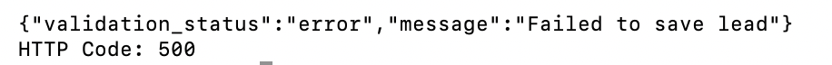

# Testing Documentation

## Test Environment

- n8n Cloud
- Google Sheets
- macOS Terminal
- cURL
- Synthetic customer data

## Import Verification

The sanitized workflow was imported into n8n and configured with a separate Google spreadsheet.

The import preserved:

- 17 functional nodes
- 5 documentation Sticky Notes
- Node connections
- Validation logic
- Service classification
- HTTP response configuration

## Imported Workflow Tests

| ID | Test Scenario | Expected Result | Actual Result | Status |
| --- | --- | --- | --- | --- |
| T01 | Create AI chatbot lead | HTTP 200 | Lead saved | PASS |
| T02 | Create website lead | HTTP 200 | Lead saved | PASS |
| T03 | Update existing email | HTTP 200, no duplicate | Existing record updated | PASS |
| T04 | Invalid email format | HTTP 400 | Request rejected | PASS |
| T05 | Missing API key | HTTP 403 | Access denied | PASS |

## Additional Development Tests

The following tests were performed on the original workflow and its separate error-testing copy.

| ID | Test Scenario | Actual Result | Status |
| --- | --- | --- | --- |
| T06 | Numeric name instead of string | HTTP 400 | PASS |
| T07 | Name containing only digits | HTTP 400 | PASS |
| T08 | Incorrect API key | HTTP 403 | PASS |
| T09 | Google Sheets failure in chatbot branch | HTTP 500 | PASS |
| T10 | Google Sheets failure in other service branch | HTTP 500 | PASS |

Storage failures were intentionally simulated using a nonexistent spreadsheet sheet.

## Final Imported Spreadsheet

| name | email | service | status |
| --- | --- | --- | --- |
| Emily Updated | emily@example.com | AI chatbot | Ai chatbot lead |
| James | james@example.com | Website | Other service lead |

The final test spreadsheet contained exactly two records.

Repeated requests using an existing email updated the corresponding record.

Invalid and unauthorized requests did not create additional rows.

## Test Evidence

### Workflow Architecture

### Google Sheets Results

### Successful Request

### Validation Error

### Technical Error

These screenshots document development tests. The final imported-workflow results are recorded separately above.

## Testing Limitations

The following areas have not been tested:

- Concurrent requests
- High-volume traffic
- Rate limiting
- Long-term production reliability

## Conclusion

All five final imported-workflow tests passed.

Five additional development tests confirmed input validation, authentication, and technical error handling.

The workflow is a functional portfolio project that can be imported and configured with the user's own credentials and Google spreadsheet.
